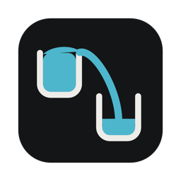
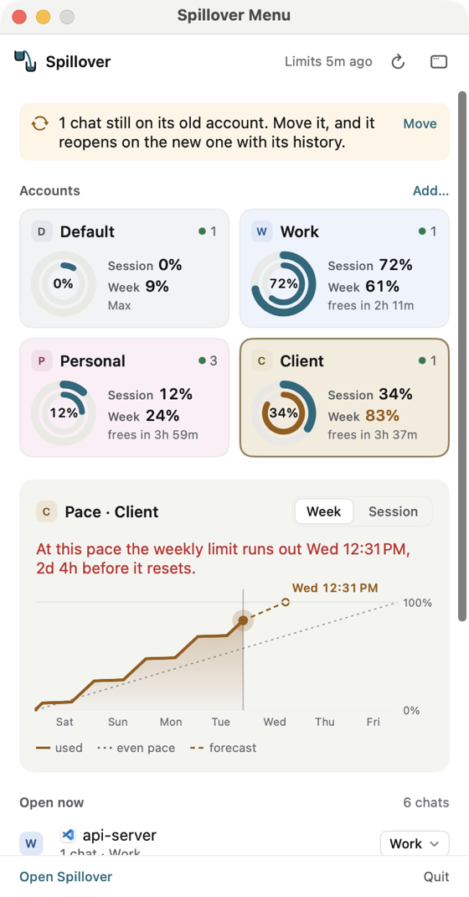
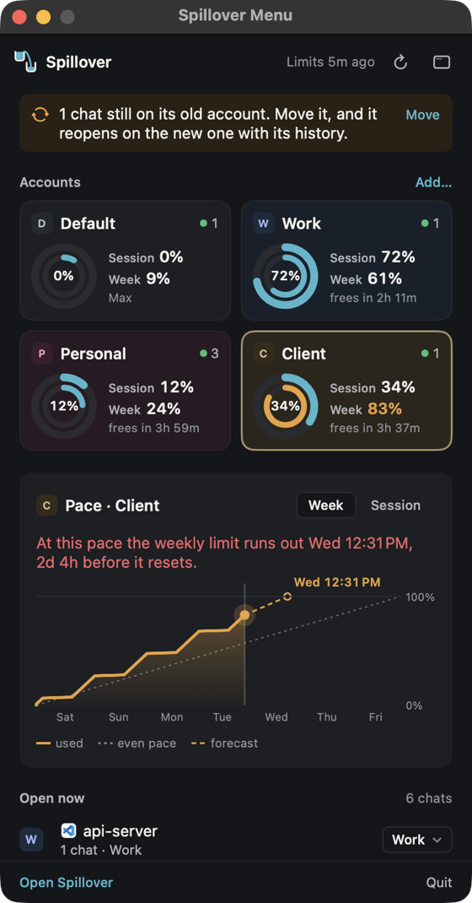
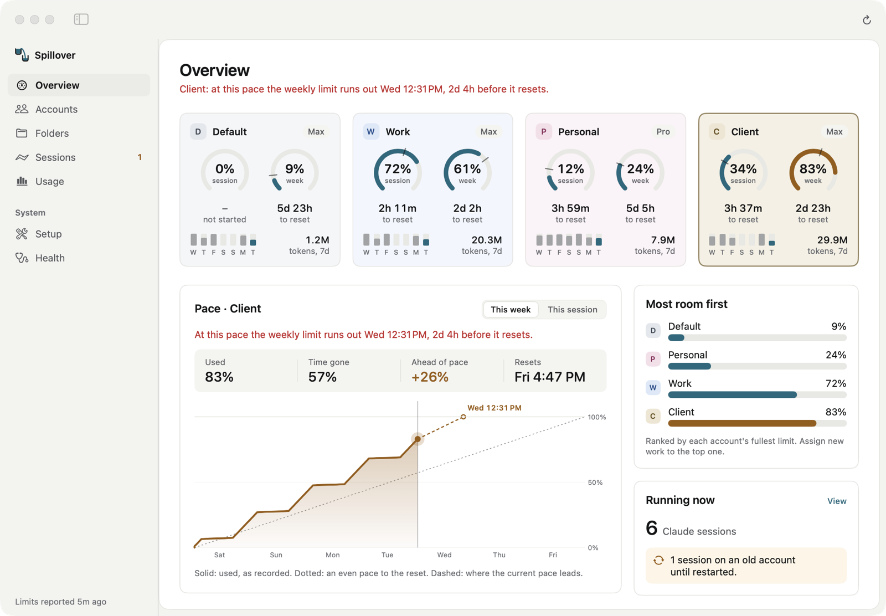
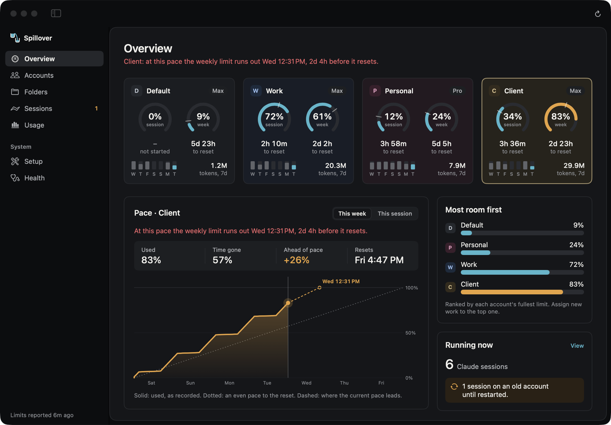
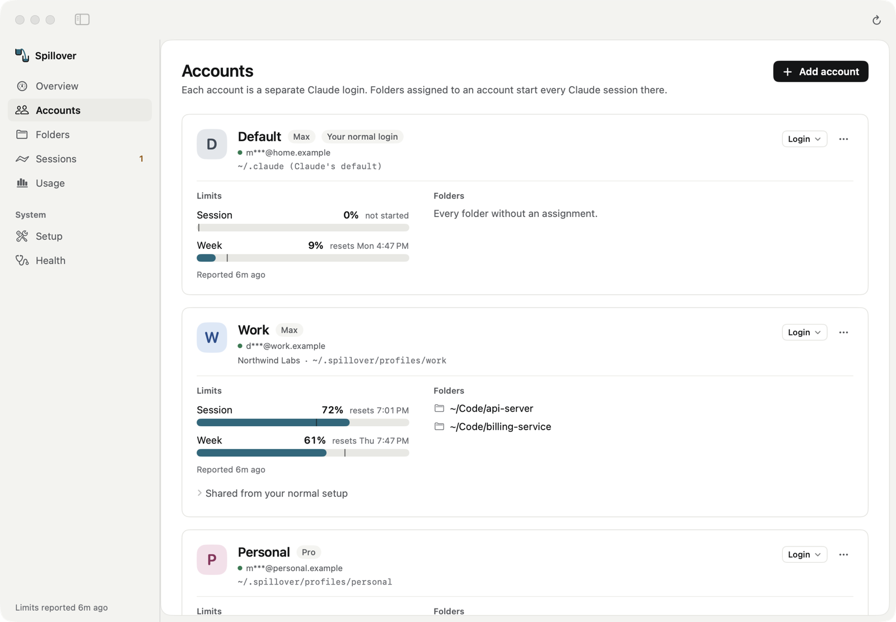
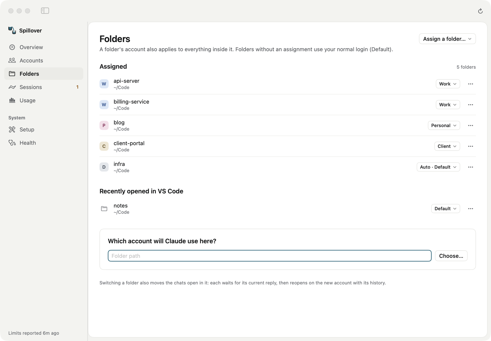
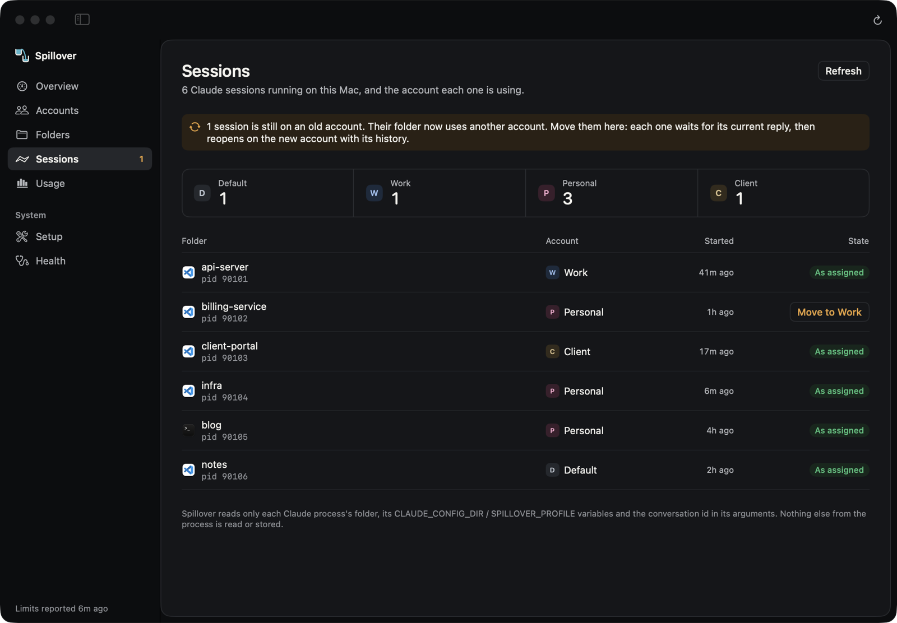
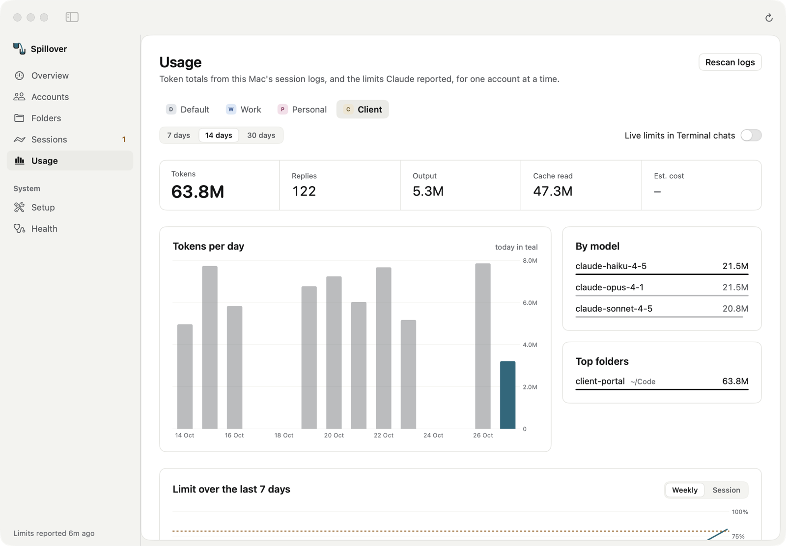

<p align="center">
  
</p>

<h1 align="center">Spillover</h1>

**One Claude subscription per folder, window and terminal — on the same Mac.**

You have more than one Claude subscription (say, *Work* and *Personal*). Claude Code keeps one login per machine, so switching accounts in one VS Code window switches it everywhere. Spillover fixes that: assign each project folder to an account, and every new Claude session in that folder — in the VS Code Claude panel, in VS Code's terminal, or in any other terminal — uses that account. Other windows keep theirs.

It lives in the menu bar and also shows each account's session and weekly limits. Closing its window, or quitting it from the Dock, keeps it running in the menu bar; choose **Quit Spillover** in its menu (or press Option-Command-Q) to quit completely.

- **Per-folder accounts** in a single, normal VS Code. No extra VS Code instances, no profile juggling.
- **Every launch path**: the Claude Code editor panel, `claude` in VS Code's terminal, iTerm, Ghostty, Terminal.
- **Move open chats**: switch a VS Code window to another account and its chats move with their history, each after its current reply.
- **Auto**: folders set to Auto start each chat on the account with the most room and move chats on when an account reaches its threshold (90% by default); a resumed chat stays on its account while that account has room.
- **Resume after limits** (opt-in): chats stopped by a usage limit continue on their own, in their own VS Code panel, a minute after their account has room again, and chats Auto moves pick their background work back up on the new account. The Overview shows what will resume and when.
- **Shared setup**: new accounts can reuse your skills, agents, commands, plugins, hooks and MCP servers; logins, history and sessions stay separate per account.
- **Usage at a glance**: 5-hour and weekly limits for every account, checked every few minutes the way `/usage` does (no message sent), pace forecasts, and token totals from local session logs. Optional notifications at 80% and 95%.
- **Live sessions**: every running Claude chat, which account it is on, and which ones still use an old account after you reassigned their folder.
- **Light, dark or system** appearance, in the window and the menu bar.
- **Safe by design**: it never reads, copies or stores a login token; every change to your editor or shell is backed up and can be undone with one button.
- **Free and open source** (MIT). No account, no telemetry, no network requests of its own.

> Status: early (0.1). macOS 14+. Claude Code first; Codex and other tools are planned.

## Screenshots

<p align="center">
  
  &nbsp;
  
</p>





| Accounts | Folders |
| --- | --- |
|  |  |
| **Sessions** | **Usage** |
|  |  |

All screenshots use made-up sample data (`scripts/seed-demo.swift`).

## How it works

Claude Code reads its configuration — including which login to use — from `CLAUDE_CONFIG_DIR`. Each Spillover **account** is simply its own config directory with its own login (Claude Code stores each directory's login in a separate macOS Keychain item).

The Claude Code VS Code extension has a user setting, `claudeCode.claudeProcessWrapper`, that names a program to run instead of Claude. Spillover points it at its small launcher. Every time a Claude session starts, the launcher looks at the session's folder, picks the account assigned to it, sets `CLAUDE_CONFIG_DIR`, and hands over to the real Claude binary. Terminals get the same behaviour through a `claude` command placed first on your `PATH`.

```text
VS Code Claude panel ─┐
VS Code terminal ─────┼─► spillover-launch ──► which account owns this folder? ──► real claude
any other terminal ───┘                          (routes you set in the app)         with that account
```

Rules:

- A folder's account applies to everything inside it. The most specific assignment wins.
- Folders you never assigned behave exactly as before (your normal login).
- If an assignment cannot be honoured (account removed, its folder missing, settings unreadable), Claude **refuses to start** in that folder and says why, rather than silently using a different subscription. Emergency override: `SPILLOVER_BYPASS=1`.
- Changes apply to **new** sessions. A chat that is already open keeps its account until you start a new one.

## Install

Spillover needs macOS 14 (Sonoma) or later and runs on Apple silicon and Intel Macs.

### Download

1. Download **Spillover-x.y.z.dmg** from the [latest release](https://github.com/Saad-ISAA/spillover/releases/latest).
2. Open it and drag **Spillover** onto **Applications**.
3. Open Spillover from Applications. It lives in the menu bar.

Each release lists SHA-256 checksums in `SHA256SUMS` (`shasum -a 256 Spillover-x.y.z.dmg` to compare).

If macOS says the app cannot be opened because it is from an unidentified developer, go to
**System Settings → Privacy & Security** and choose **Open Anyway** next to Spillover (needed once).

### Homebrew

```sh
brew install --cask saad-isaa/spillover/spillover
```

This also puts the `spillover` command on your `PATH`. Update with `brew upgrade --cask spillover`.

### Build from source

Needs Xcode or the Xcode Command Line Tools; no Apple developer account.

```sh
git clone https://github.com/Saad-ISAA/spillover.git
cd spillover
scripts/build-app.sh
cp -R dist/Spillover.app /Applications/
open /Applications/Spillover.app
```

### Uninstall

In Spillover, choose **Setup → Undo all changes** first, so your editor and shell settings go back
to how they were. Then quit Spillover from its menu and move it to the Bin (or
`brew uninstall --cask spillover`). Your accounts stay in `~/.spillover`; delete that folder if you
no longer need them (their logins stay in Keychain until you log out of each first).

## First steps (in the app)

1. **Accounts → Add account.** Name it (e.g. *Work*), choose which of your existing settings, skills, commands and MCP servers to reuse, and log in: a Terminal window opens the official `claude auth login`. Log in with the subscription you want for that account. Repeat for each subscription.
2. **Folders → Assign a folder…** Pick the account, then the project folder. Recent VS Code folders are listed with a one-click account picker.
3. **Setup → Visual Studio Code → Connect.** Then start a new Claude chat (or reload the window).
4. Optional: **Setup → Terminals** so `claude` in any terminal follows the same assignments, and **Usage → Live limits in Terminal chats** if you want limits updated after every Terminal reply.

Already using `CLAUDE_CONFIG_DIR` folders by hand? **Accounts → Add account → Existing config folder** adopts them and keeps their logins.

## What Spillover changes on your Mac

| Where | What | Undo |
| --- | --- | --- |
| `~/.spillover/` | Its own state: accounts, folder assignments, launcher, logs, backups | delete the folder |
| VS Code user `settings.json` | one key: `claudeCode.claudeProcessWrapper` (backup kept) | Setup → Disconnect |
| `~/.zshrc` | a marked block that puts `~/.spillover/shims` first on `PATH` (only if you turn on Terminals) | Setup → Terminals off |
| An account's Claude `settings.json` | `statusLine` set to Spillover's usage recorder; your own statusline keeps running (only if you turn on Live limits in Terminal chats) | Usage → Live limits in Terminal chats off |

**Setup → Undo all changes** reverts every row above in one step. Accounts, logins and folder assignments are kept.

## Usage limits

Spillover checks every account's 5-hour and weekly limits every few minutes, the same way Claude Code's `/usage` does and without sending a message: it runs `claude -p /usage` for the account (a local command that uses no tokens) and reads the usage that Claude caches in the account's `.claude.json`. Spillover never reads your login. Optionally, *Usage → Live limits in Terminal chats* also records limits after every reply in Terminal chats, through Claude's statusline.

Token totals come from each account's local session logs (`projects/**/*.jsonl`). Spillover reads only the usage counters, model and folder of each reply. It ships no prices; to see estimated cost, add your own `~/.spillover/prices.json`:

```json
{ "models": { "claude-opus": { "input": 15, "output": 75, "cacheWrite": 18.75, "cacheRead": 1.5 } } }
```

(USD per million tokens; keys match model ids by prefix. Unknown models are reported as unpriced, never as zero.)

## Command line

The app bundles a CLI with the same features, handy for scripts and troubleshooting:

```sh
spillover status                     # accounts, logins, limits, assignments, setup
spillover route which ~/Code/app     # which account would Claude use here?
spillover sessions                   # running Claude sessions and their accounts
spillover stopped                    # chats stopped by a usage limit, and when each resumes
spillover doctor                     # read-only health checks
spillover log 20                     # recent launch decisions
spillover help                       # everything else
```

After connecting anything in the app, the CLI is at `~/.spillover/bin/spillover`.

## Limitations

- macOS only for now. Remote development (SSH, containers, WSL) runs Claude on the remote machine, outside Spillover's reach.
- Relies on the Claude Code extension's `claudeCode.claudeProcessWrapper` setting. **Health** warns if an extension update changes it.
- The Claude panel's *Account & Usage* view may show “Auth method: Not specified” for routed sessions; the account, plan and usage shown are correct.
- Resuming chats types into VS Code through the Accessibility permission. Builds are not signed with a Developer ID yet, so after an update macOS may keep showing Spillover as allowed while ignoring it: remove it from **Privacy & Security → Accessibility** with **–** and allow it again.
- Logins themselves are handled entirely by Claude Code. Spillover does not log you in or out by itself; it opens the official commands.

## Security

See [SECURITY.md](SECURITY.md) and [docs/threat-model.md](docs/threat-model.md). In short: no token access, owner-only files, fail-closed routing, no network access of its own (limits are read through the official Claude CLI), and every change reversible.

## License

MIT — see [LICENSE](LICENSE).

Spillover is an independent project. It is not affiliated with or endorsed by Anthropic. Claude and
Claude Code are trademarks of Anthropic.
